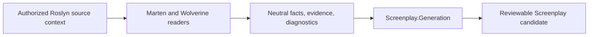

When a Marten or Wolverine convention is missing from the recovered model, start with the authored source that proves it. This guide follows an existing storage-action fixture through the Screenplay.CritterStack readers to its relationship assertions, so you can place a new rule and decide what evidence it needs.

Read [Build a .NET source adapter](/screenplay/generation/guides/build-source-adapter/) first for the shared contract. Screenplay.Generation owns adapter composition, neutral facts, evidence, source identity, resolution, lowering, canonical printing, and compiler verification. This repository owns only Marten and Wolverine interpretation; adding a framework rule does not move those shared responsibilities into the adapter.



## Choose the framework owner

Choose the reader from the framework contract you need to recognize, not from the Screenplay syntax you hope to produce. For the storage-action example below, return-slot classification belongs to `WolverineReturnConsequences`; relationship emission belongs to `WolverineFacts`. Use the ownership table to make the same choice for another source shape.

| Source concern | Current owner |
| --- | --- |
| Marten documents and identities | `MartenDocumentFacts` |
| Marten projections and configuration | `MartenFacts` and focused `Marten*Discovery` helpers |
| Marten event schema and tenancy | Focused event-schema and tenancy discovery helpers |
| Wolverine handlers and consequences | `WolverineFacts` |
| Wolverine discovery policy | `WolverineHandlerDiscovery` |
| Wolverine return slots | `WolverineReturnConsequences` |
| Wolverine sagas | `WolverineSagaFacts` |
| Framework-neutral Roslyn and source mechanics | Screenplay.Generation |

Create a focused discovery helper when a concern needs its own admission rules or diagnostic family. Keep the top-level readers as orchestration and neutral fact-emission boundaries. Do not add Screenplay syntax construction or lowering to this adapter.

## Match semantic framework identity

Prove which framework contract a source shape uses before giving it domain meaning. Record exact metadata names in `WellKnownTypes.cs`, then match bound Roslyn symbols. For example, the storage-action classifier recognizes the generic contract and its interface implementations; the spelling of a local type is not enough.

- Use `OriginalDefinition` for generic contracts.
- Use `ReducedFrom` for extension methods.
- Walk interfaces or base types only when the framework contract defines inheritance.
- Require the host's authoritative authored-tree set before a declaration originates facts.
- Never match only a short method or attribute name.

The production adapter has no Marten or Wolverine runtime dependency. Metadata matching lets one adapter inspect the exercised framework generations without loading those runtime assemblies into the host.

For overloaded methods, use a full .NET documentation method identity. A short method name cannot distinguish overloads and must not become a subject or fact identifier.

## Admit the context before reading a body

First establish that the enclosing source is an admitted handler, endpoint, projection, subscription, listener, or configuration context. Only then inspect its exact bound invocations and arguments. Finding a familiar call in a body does not establish the context that gives the call framework meaning.

Keep a close lookalike outside that context in the negative specification: a same-named call in unrelated source must contribute nothing. If Roslyn cannot resolve an exact symbol, report or omit the unresolved behavior rather than treating candidate symbols as authority.

## Classify each consequence independently

Classify each tuple slot and body effect separately. A handler can return a response, persist a document and send a message; recognizing one consequence must not erase another, and an unknown sibling must not discard a supported one. Use the following list as a classification checklist, not as mutually exclusive labels for the whole handler.

- HTTP response
- persisted event
- event-stream append or start
- document store, update, or delete
- local cascade
- explicit publish or send
- delayed delivery
- side effect
- saga state
- storage action

Do not classify a source-authored wrapper, response, message, or document as an event merely because its type is local. `WolverineReturnConsequences` separates return slots; `WolverineFacts` emits only relationships established by the classified result.

To follow one complete case, open `Source/DotNET/CritterStack.Specs/given/a_storage_action_handler_application.cs`. Its `MixedStorageActionsRequestedHandler` returns three storage-action slots for the same `ManifestDocument`: `Storage.Store`, `Storage.Delete` and `Storage.Nothing`. Sharing an entity type does not make those slots the same consequence.

`WolverineReturnConsequences` recognizes the storage-action contract before falling back to ordinary payload classification. `WolverineFacts.StorageActions.cs` then inspects the returned factories by slot: the first slot contributes `Stores`, the second contributes `Deletes`, and the third contributes no document-write relationship.

Read `Source/DotNET/CritterStack.Specs/for_CritterStackScreenplayAdapter/when_analyzing_storage_action_returns.cs` beside that fixture. It asserts the two relationship kinds independently, excludes discriminator `storage-action:2`, requires exact storage-action evidence, and expects no loss diagnostics. `Storage.Nothing` is a deliberate no-write result here, not unsupported behavior that needs a loss warning. These are assertions in an existing static-analysis specification, not an observed runtime result.

When flow is unresolved, retain a conservative relationship only if the framework contract still proves it. Otherwise emit a diagnostic and omit the guess.

## Keep evidence contributions independent

After classifying a consequence, keep its evidence independent of observations from the other framework. Marten and Wolverine may describe the same source subject: give compatible observations the same stable subject identity and let Generation merge them. Calling one framework reader from another to manufacture precedence, or allowing reader order to select semantics, would hide the distinction the evidence needs to preserve.

Use evidence strength deliberately:

| Strength | Use |
| --- | --- |
| Exact | Bound invocation, attribute, interface, override, or return type |
| Configured | Authored framework registration or configuration |
| Conventional | Documented convention after exact admission |
| Heuristic | Display or placement suggestion only |

Equally strong incompatible facts must remain visible conflicts. Heuristic evidence must not establish persistence, stream ownership, authorization, or another correctness-critical role.

## Report bounded loss

When authored behavior cannot be represented, make the loss distinguishable from a deliberate no-op such as the storage-action example. Allocate a stable diagnostic code in the owning framework catalog. Include the severity, outcome, affected subject, authored source location, and a message that separates the observed source from the behavior that was not represented.

For a custom policy, listener, middleware or other unbounded extension body, report its presence rather than attempting to recover arbitrary behavior from the body. Do not interpret arbitrary extension code to suppress a warning. Hosts must display diagnostics even when generation has no error diagnostics.

The convention-alteration case shows what to assert for that boundary. `WolverineConventionAlterationDiscovery` reports `WOLVERINE0019` with a warning severity and an `Unsupported` outcome: the recovered model reflects default conventions, not the custom policy's runtime behavior. In `Source/DotNET/CritterStack.Specs/for_CritterStackScreenplayAdapter/when_analyzing_convention_alterations.cs`, the assertions check the diagnostic and preserve the baseline fact IDs. A presence warning is not permission to invent replacement facts.

## Add focused specifications

Turn the source shape and expected classification into assertions before treating a new rule as recovered behavior. Give each behavior a minimal authored-source scenario and a corresponding analysis specification. The storage-action case pairs relationship and discriminator assertions with an empty diagnostic set; the convention-alteration case pairs an exact diagnostic with unchanged facts. For your change, prove:

1. the framework stub and application compile;
2. exact artifacts and relationships;
3. optional, collection, and discriminator metadata where relevant;
4. close lookalikes do not match;
5. unsupported or unresolved source reports the exact code and outcome;
6. events, messages, responses, and documents are not conflated;
7. unrelated facts and diagnostics are absent; and
8. overloads and reversed input order remain deterministic.

Keep framework stubs local to the scenario. A shared fake framework couples unrelated specifications and can hide accidental assumptions.

## Check exercised compatibility

Use pinned public Marten and Wolverine samples for package-level compatibility. Use purpose-built authored-source fixtures for bounded positive and negative semantic cases. Do not import private source or create fixture names and content derived from a product.

Compatibility checks should pin semantic assertions as well as source hashes. Generate twice and compare the resulting bytes. Treat the resulting matrix as evidence for the exact exercised versions, not as an open-ended support guarantee.

## Run the repository gates

For an implementation change, run the .NET Build sequence below from the repository root, using the SDK selected by `global.json`. The specification runner checks that a nonzero number of tests ran; a successful build is not a specification result. It also requires `python3` to validate the results. Its self-test uses Node.js. The package-consumer script uses a temporary package cache when `NUGET_PACKAGES` is unset; do not substitute a warm developer cache for the clean-consumer check.

```shell
dotnet restore --property:Configuration=Debug
dotnet build --configuration Debug --no-restore --warnaserror
bash .github/scripts/run-specifications.sh --self-test
dotnet restore --property:Configuration=Release
dotnet build --no-restore --configuration Release -p:Version=9999.0.0 --warnaserror
bash .github/scripts/run-specifications.sh Release
dotnet pack --no-build --configuration Release -o ./Artifacts/NuGet -p:Version=9999.0.0
./scripts/verify-package-consumer.sh 9999.0.0 ./Artifacts/NuGet
```

Stop at a failed check before running dependent steps. Keep its command, exit status and first relevant error with the source shape you changed. In a human or AI-assisted handoff, name the reader, expected facts and omissions, diagnostic identifiers, and checks actually run; do not report a specification you only read as a passing test.

The pinned compatibility matrix is defined by `.github/workflows/canonical-samples.yml` and is a separate check, not a result established by the commands above. Review every generated-source change before accepting an expectation update. If a sample check cannot be run, record that gap rather than extending the exercised compatibility claim.

## Stop at the ownership boundary

An adapter contribution ends with neutral facts, evidence, and diagnostics. Screenplay.Generation resolves and lowers those contributions. The host owns workspace evaluation, provider admission, output, and publication.

This adapter does not prove automatic migration, runtime equivalence, Studio workflow integration, Stage execution, or production support. A separate rendering target must follow the canonical [Stage renderer-target guide](/screenplay/stage/guides/build-renderer-target/). If a proposed change needs one of those claims, it requires independent accepted evidence outside this case study.
